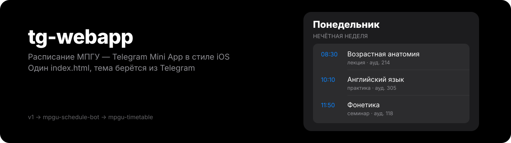

<p align="center"></p>

<div align="center">


</div>

## Возможности

- Расписание групп с выбором подгрупп и практик
- Оформление в стиле iOS: цвета берутся из темы Telegram, светлая и тёмная темы
- Данные — в `groups.json`, интерфейс — один файл `index.html` без сборки и зависимостей
- Работает на GitHub Pages, открывается кнопкой в боте

## Файлы

```
index.html    интерфейс мини-приложения
groups.json   расписание групп и варианты подгрупп
```

## Что дальше

Проект вырос в полноценное приложение с сервером, ролями, посещаемостью и версиями для Android и iOS — **[mpgu-timetable](https://github.com/lvovkonstantin57-del/mpgu-timetable)** · [mpgu-timetable.ru](https://mpgu-timetable.ru)

---

<sub>Автор — [Константин Львов](https://github.com/lvovkonstantin57-del) · [Telegram](https://t.me/l1ttleStich)</sub>
